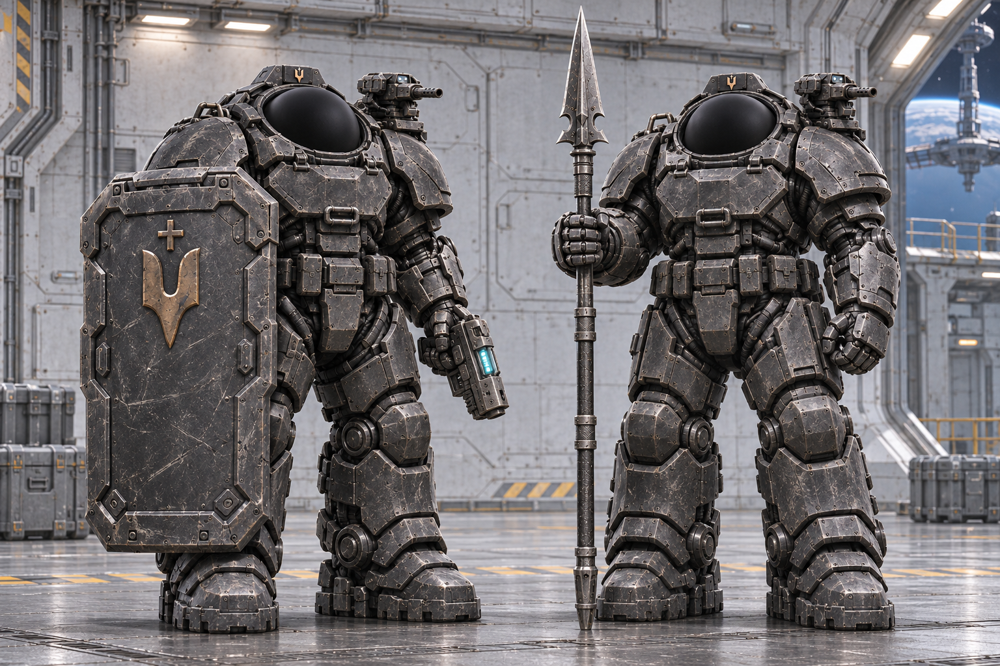
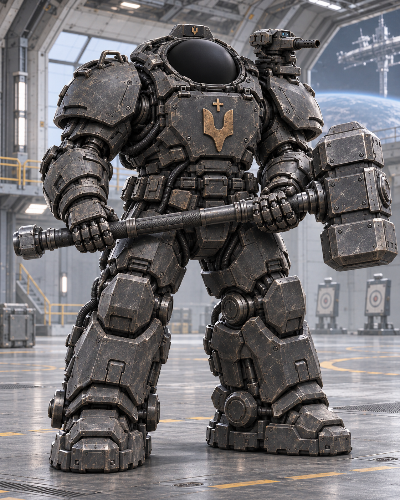
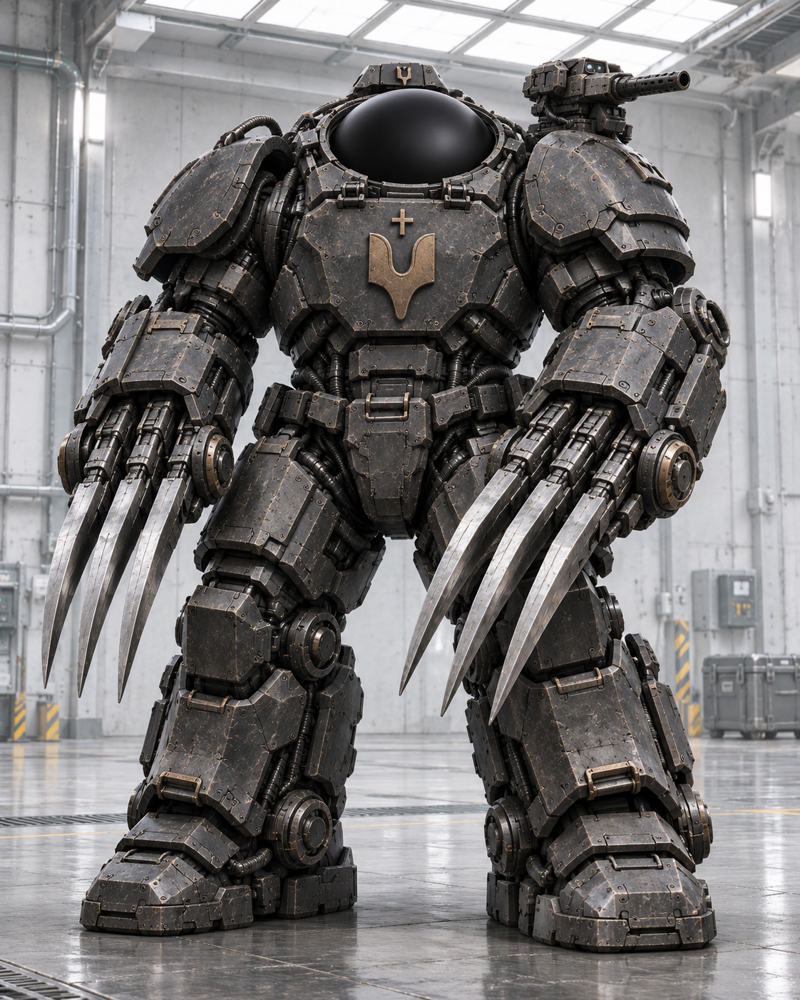
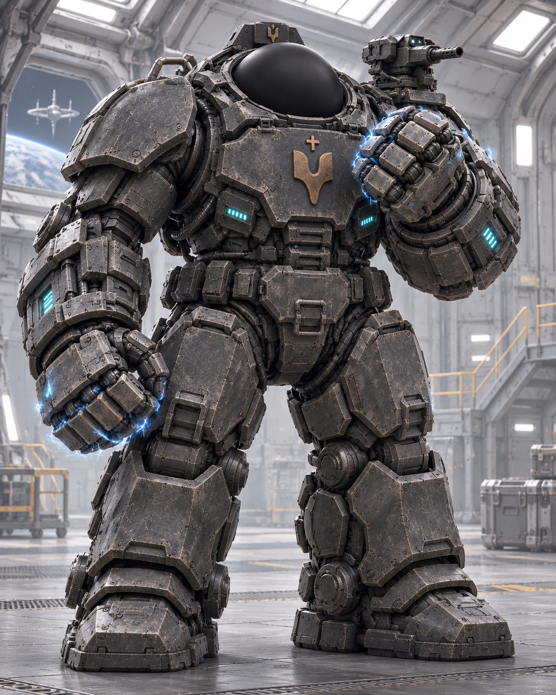
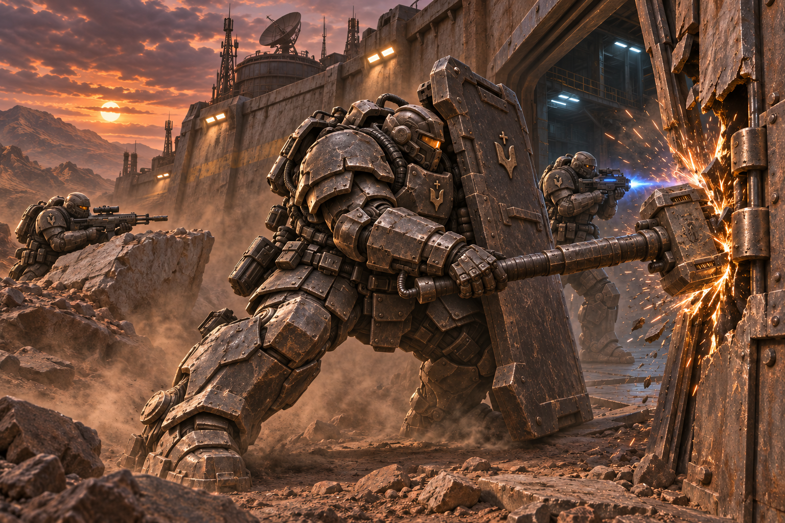

A [[Terminator|Terminator]] variant specialized for close assault. They have thicker armor and a more open visor for better visibility.

## Training

Selection begins at the rank of Terminator III for separate training and retraining in close assault. Preference is given to Cossacks with slightly reduced mental abilities but stronger psychological resilience for extremely brutal close fighting, when the enemy must literally be torn in half by hand.

## Weapons

Terminator shield  
[[../Weapons/Short Plasma Handgun|Short Plasma Handgun]]  
Grenades  
Chest-breakers  

Fists  

Heavy plasma infantry saber  
[[../Weapons/Combat Hammer|Combat Hammer]]  
[[../Weapons/Javelin Spear|Javelin Spear]]

## Armor

Structurally, the armor is identical to [[Terminator|Terminator]] armor, but it is slightly larger and has thicker protective plates. The Bruisers' visor is more open to make orientation in space easier. On magnetic holders across the back, they carry several spare armor plates for rapid replacement during battle.

## Use

They enter battle first. Their task is to punch as deeply as possible into enemy ranks and sow panic, destroying enemies in close combat by barbaric methods. The weapons carried by Bruisers terrify unaccustomed soldiers. Usually, after Bruiser strikes, human bodies come apart with instant depressurization.

*Breaching a planetary fortification under covering fire from fellow Terminators.*

## Strengths

Inflicting morale shock on the enemy. Forcing a breach even through concrete shelters and engineering obstacles. In close combat they are effectively invulnerable.

## Weaknesses

Because of their increased protection, they need frequent battery replacements in the spacesuit and can therefore remain in battle for only a few hours before withdrawing. Because of the physical and psychological strain, they need rest or combat stimulants for faster recovery.

They are vulnerable to heavy infantry and artillery fire. Because of their larger size, they are easier to hit.

## Analogues in Other Empires

[[../../Empire of the Sun/Military Affairs/Samanaki|Samanaki]] from the [[../../Empire of the Sun/Military Affairs of the Empire of the Sun|Empire of the Sun]]
