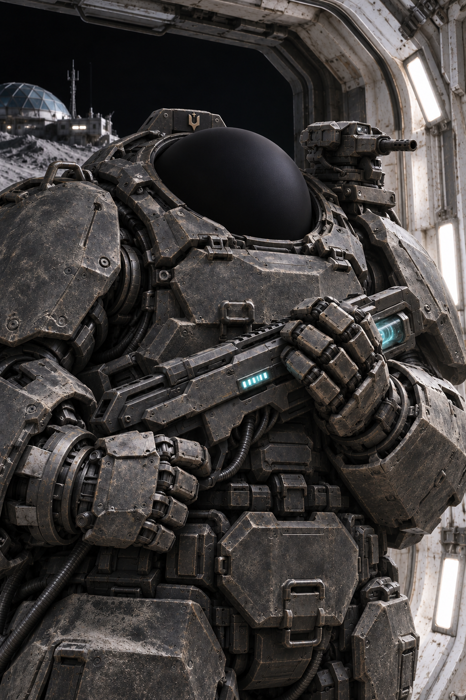
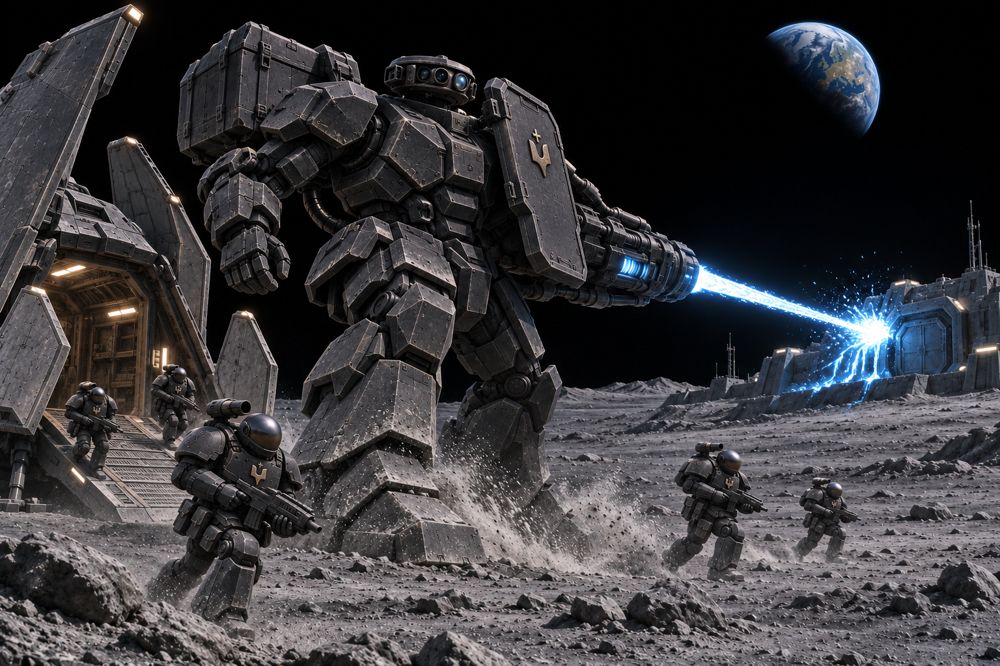
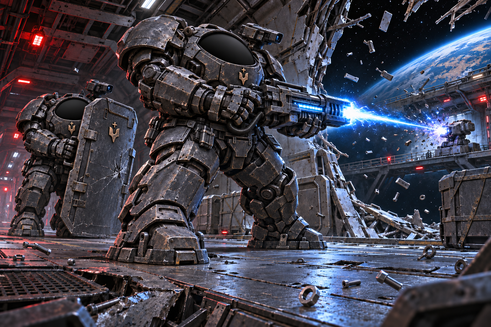
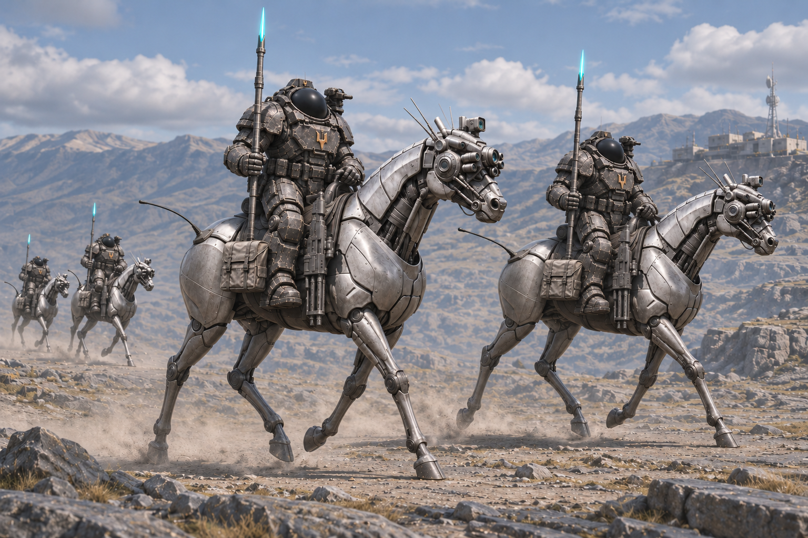

Сердюки - це основні військові сили [[../Федерація Гетьманату|Федерація Гетьманату]]. Беруть участь в усіх активних бойових діях та, на відміну від [[Гайдуки|Гайдуків]], проводять наступальні операції.

*Надважкий сердюк біля шлюзу місячної бази.*

## Задачі
### Боротьба з [[Харцизи|Харцизами]]
Всі космічні паланки мають в розпорядженні декілька полків сердюків. Таким чином кожна паланка може вести наступальні операції. Наприклад, якщо в системі з'являються [[Харцизи]], то сердюкам доручають знищити основні їх сили, або знизити їх до такого рівня, щоб [[Харцизи]] знову визнали владу імперії.

![[../../../../Images/Universe/Hetmanate-Federation/SpaceCossacks/Terminator_On_Moon.png]]
## Зовнішні загрози
Хоча відкриті конфлікти між імперіями трапляються доволі рідко, саме сердюки беруть у них найактивнішу участь.

*Мех із «Коником» розчищає місячний плацдарм для сердюків.*

## Озброєння
Всі нові типи озброєння надходять до сердюків у першу чергу. Оскільки вони дуже часто беруть участь у космічних чи планетарних битвах, то з їхньою допомогою можна дуже швидко обкатати нові винаходи та вдосконалити їх. Саме сердюки вперше випробували [[Термінатор|термінаторські обладунки]], які були скопійовані з трофеїв після зустрічі з космічними десантниками [[../../Корпоративна Республіка/Корпоративна Республіка|Корпоративної Республіки]].

## Навчання

## Види сердюків

#### Космічні Піхотинці

*Штурм станції: вогнева підтримка та просування під прикриттям щита.*

#### Літуни

#### Кавалерія

*Кінний патруль сердюків на броньованих бот-конях.*

#### Пластуни
Легкі розвідники. Бувають як космічні пластуни так і звичайні - планетарні. Головні завдання пластунів - розвідка поверхонь планет, регіонів в космосі. Рідко вступають у бій, лише коли перемога гарантована. В іншому випадку збирають потрібну інформацію та передають її основним силам. Основна перевага — швидкість і мобільність. Також використовуються для перерізання логістики ворога під час планетарних осад або космічних рейдів.
#### Планетарні війська
Мають лише легкі скафандри для ведення бойових дій на планетах, які до кінця не тераформували до придатного для життя рівня без використання респіраторів чи інгаляцій. Мають в своєму розпорядженні всі види озброєння: артилерія, кавалерія, танки, літуни. Сердюки з таких підрозділів рідко беруть участь в космічних боях на місяцях чи штучних супутниках. 

