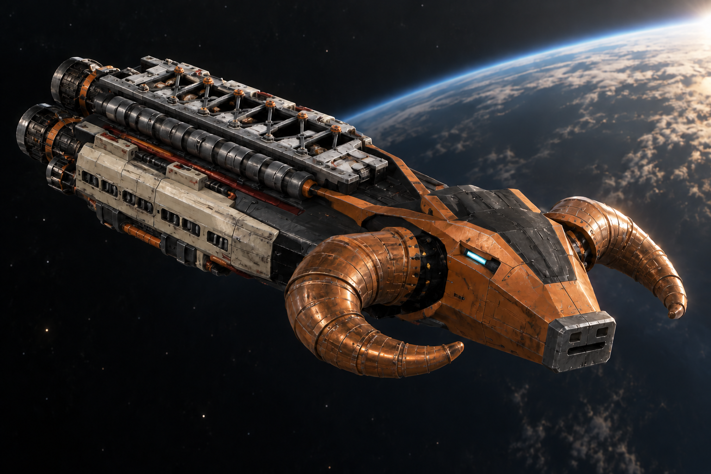
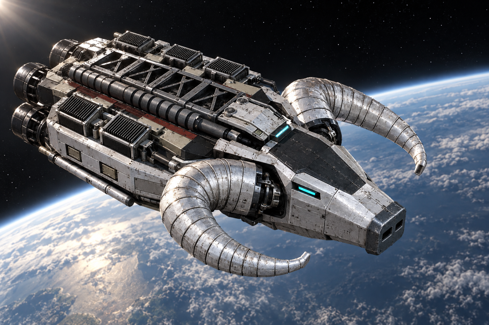
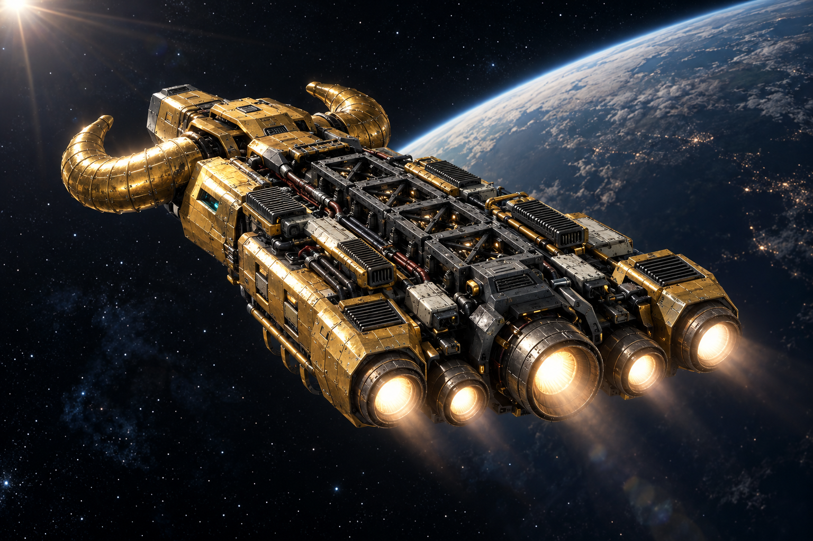

# Таранний корабель «Лом»

*Модифікація «Лома» з бронзовою ударною частиною, закрученими рогами та світлими бортовими кожухами.*

**«Лом»** — спеціалізований таранний корабель [[../../Федерація Гетьманату|Федерації Гетьманату]]. Його зброя — власний посилений корпус: корабель наздоганяє противника, розганяється на останній ділянці зближення й завдає контактного удару носом. На відміну від [[Сокіл|«Сокола»]], [[Кораблі класу Тавр|«Тавра»]] та [[Дуб|«Дуба»]], «Лом» не має гармат, ракетних установок чи допоміжних бойових турелей. Уся конструкція підпорядкована розгону, зіткненню та виходу на наступний захід.

## Корпус і таранна голова

Носова частина має впізнавану форму механічної баранячої голови. Широкий гранований лоб звужується до короткого носа зі змінною тупою сталевою ударною накладкою. Під металевими надбрівними виступами розташовані заглиблені блакитні оптичні сенсори. Вони стежать за ціллю під час зближення; їхнє світіння не є променем зброї.

Два масивні роги розходяться в боки й закручуються всередину, залишаючи відкриті проміжки навколо голови. Це інженерні ударні конструкції з металевих сегментів, кільцевими ребрами підсилення та великими кріпленнями біля основи. Силові поршні й захищені магістралі з'єднують носовий вузол із поздовжньою рамою корабля.

За головою тягнеться відкритий технічний хребет із шістьма секціями діагональних розпірок. Між ними видно охолоджувальні ребра, а вздовж рами проходять товсті трубопроводи з кільцевими кріпленнями. Світлі бортові бронекожухи мають окремі сервісні панелі, люки й вентиляційні прорізи. На нижньому боці розміщені додаткові розпірки, трубопроводи охолодження, балони та центральний герметичний люк.

У модифікації з вузьким корпусом бронзові голова й роги контрастують із темною сталлю механізмів, світлою обшивкою та стриманими червоно-коричневими службовими смугами. Три основні кормові сопла мають відкриті металеві стінки й заглиблені світні осердя; над ними розташовані малі маневрові сопла.

## Бойовий цикл

«Лом» атакує послідовними заходами. Спочатку він переслідує обрану ціль, коригуючи напрямок за її рухом. На завершальній ділянці вмикає форсаж і спрямовує ударну накладку в корпус противника. Сила зіткнення залежить і від міцності тарана, і від швидкості зближення: повільний дотик не замінює повноцінного розгону.

Після удару корабель відходить, набирає дистанцію та повертається для нового заходу. Цей відступ є частиною атаки: «Лому» потрібен простір, щоб знову накопичити швидкість. Він не залишається біля цілі для безперервного вогню, адже стріляти йому нічим.

Зіткнення пошкоджує й сам «Лом». Посилений ніс дозволяє витримувати повторні удари, але не скасовує їхніх наслідків. Навіть переможний бій поступово витрачає запас міцності корабля.

## Модифікації

«Лом» має кілька конструктивних модифікацій зі спільною таранною схемою. Вони відрізняються шириною корпусу, захистом носового вузла, системами охолодження та компонуванням рушіїв. Усі зберігають характерну баранячу голову, пару закручених рогів і відкриту поздовжню раму. Гарматного озброєння ці модифікації не мають.

Вузькокорпусна модифікація вирізняється бронзовими головою й рогами та трьома основними кормовими соплами. Уздовж її силового хребта розташовані компактні світлі бронекожухи.

*Модифікація з розширеним корпусом: сріблясті ударні конструкції, плечові щити та відкриті теплообмінники.*

Модифікація зі сріблястими ударними конструкціями має ширший і глибший корпус. Плечові щити прикривають додаткове обладнання, а відкриті теплообмінники відводять тепло від навантажених систем. Збільшені силові підкоси передають навантаження від основ рогів на корпус. Позаду голови розміщений низький командний блок із парою вентиляторів.

Окрема модифікація із золотистим захистом лоба й плечей має товстіші роги та дві додаткові кормові рушійні гондоли. П'ять основних сопел, розподільники живлення, закріплені зовнішні магістралі й додаткові нижні акумуляторні вузли визначають її компонування. Темні ніші механізмів і світлі сервісні панелі залишаються відкритими між масивними захисними елементами.

*П'ятидвигунна модифікація, вигляд із корми. Два зовнішні двигуни розташовані в окремих гондолах; між бортами проходить відкритий технічний хребет.*

Незалежно від модифікації, таранний удар навантажує власний корпус корабля. Посилення силової рами та носового вузла допомагає витримати зіткнення, але не усуває потреби в ремонті.

## Тактика та обмеження

«Лом» призначений для прямого зближення. Йому потрібні вільний шлях до цілі та місце для повторного розгону. Вогнева підтримка інших кораблів допомагає пережити підхід, протягом якого сам таран ще не може завдати шкоди.

Головні обмеження випливають із його спеціалізації: відсутність дистанційної зброї, необхідність щоразу наближатися впритул і пошкодження власного корпусу від кожного вдалого удару. Тому пілот має стежити не лише за станом противника, а й за тим, чи витримає корабель наступний захід.
